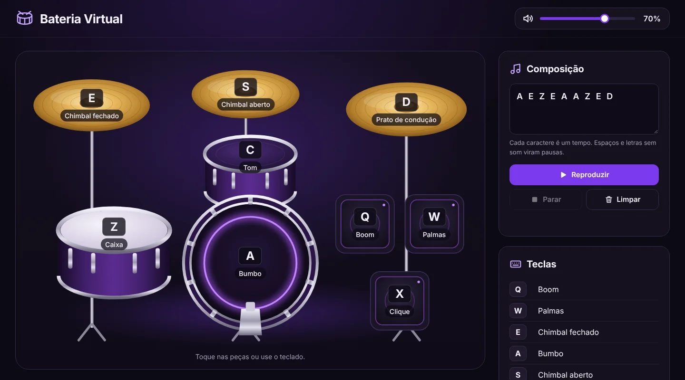
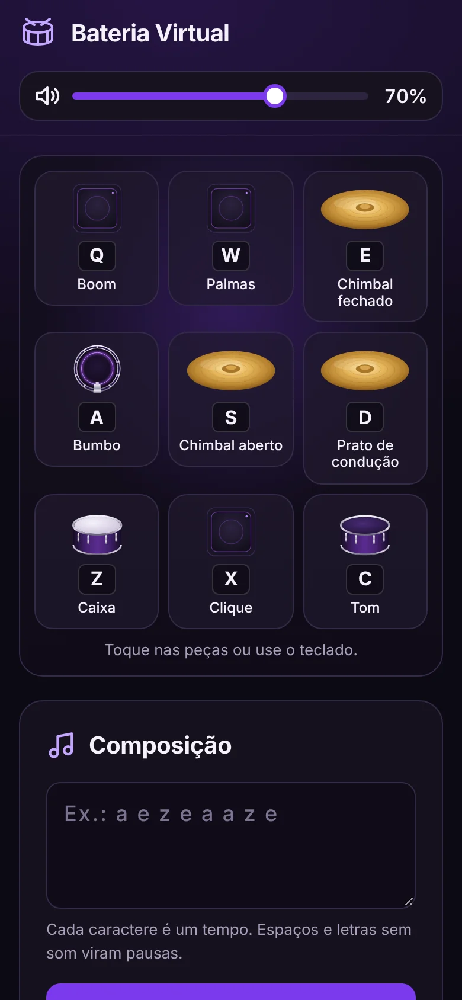

# Bateria Virtual

Bateria virtual feita com HTML, CSS e JavaScript puro. Os sons podem ser tocados pelo teclado, pelo mouse ou pelo toque, e é possível escrever uma sequência de teclas e reproduzi-la como uma pequena composição.

## Demonstração

<!-- Adicione aqui o link da versão publicada, por exemplo: https://seu-usuario.github.io/bateria-virtual/ -->





## Funcionalidades

- Nove sons de bateria tocados pelo teclado, por clique ou por toque, inclusive com vários dedos ao mesmo tempo.
- O som sai ao pressionar a tecla. Segurar a tecla não repete o som.
- Destaque visual curto na peça tocada.
- Controle de volume aplicado a todos os sons, inclusive aos que ainda estão soando.
- Composição: cada caractere digitado é um tempo de 250 ms. Letras das teclas tocam o som correspondente; espaços e outros caracteres viram pausas.
- Botões para reproduzir, parar e limpar a composição, com indicação do passo atual durante a reprodução.
- Layout responsivo: no celular, as peças viram uma grade de botões grandes.
- Acessibilidade: peças acessíveis por teclado (`Tab` + `Enter` ou `Espaço`), foco visível, rótulos nos controles e respeito à preferência por movimento reduzido.

## Mapeamento das teclas

| Tecla | Som |
| --- | --- |
| Q | Boom |
| W | Palmas |
| E | Chimbal fechado |
| A | Bumbo |
| S | Chimbal aberto |
| D | Prato de condução |
| Z | Caixa |
| X | Clique |
| C | Tom |

## Tecnologias

- HTML5 e SVG (peças da bateria desenhadas em SVG)
- CSS3 (variáveis, Grid, container queries e media queries)
- JavaScript (ES6+), com Web Audio API para reprodução e volume
- Fonte [Inter](https://github.com/rsms/inter), hospedada localmente (licença SIL OFL 1.1)

## Como executar

O projeto é um site estático e não precisa de instalação.

```bash
git clone https://github.com/seu-usuario/bateria-virtual.git
cd bateria-virtual
python3 -m http.server 8000
```

Depois acesse `http://localhost:8000`. A extensão Live Server do VS Code também funciona.

Abrir o `index.html` diretamente também funciona, mas nesse modo o navegador não permite carregar os arquivos pela Web Audio API nem a fonte local. Os sons passam a tocar pelos elementos `<audio>` e a fonte padrão do sistema é usada.

## Estrutura

```
├── index.html      Estrutura da página, desenhos das peças em SVG e elementos de áudio
├── style.css       Tema, posicionamento das peças e responsividade
├── script.js       Eventos, reprodução dos sons, volume e composição
├── sounds/         Sons da bateria (.wav)
├── fonts/          Fonte Inter e sua licença
└── docs/           Capturas de tela usadas neste README
```

## Origem do projeto

Este projeto foi desenvolvido inicialmente durante o curso de JavaScript da [B7Web](https://b7web.com.br) e, posteriormente, aprimorado para fins de estudo e portfólio: nova interface, interação por mouse e toque, controle de volume, reprodução de composições com parar e limpar, responsividade e acessibilidade.

## Créditos

- Curso de JavaScript da [B7Web](https://b7web.com.br), base do projeto original.
- Sons fornecidos no material do curso.
